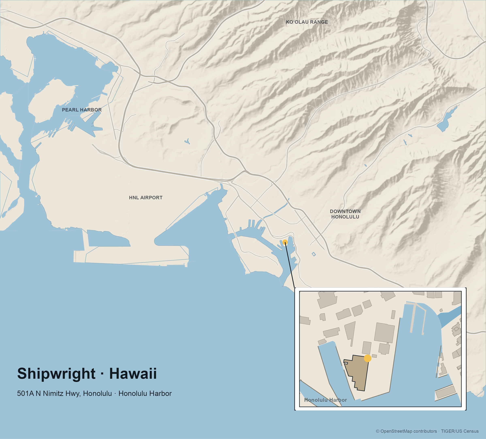

# Shipwright Maps (sw-maps)

Reusable, parameterized R pipeline that renders a flat-vector cartographic
**location map** for each Shipwright office: a main establishing map (regional
context, optional shaded terrain) with an **inset closeup** of the office
building, marked with a pin, plus a leader line tying the two together.

Outputs per office: a flat **PNG**, editable **SVG** and **PDF**, and a
**layered SVG** whose named groups open as Illustrator layers.



## Render

```sh
Rscript scripts/location_map.R hawaii     # -> outputs/location-maps/shipwright-hawaii-location-map.{png,svg,pdf} + -layered.svg
Rscript scripts/location_map.R florida
```

A new office = one new file in `configs/`. No code changes needed for the common case.

Scripts resolve the repo from `SW_MAPS_ROOT` (default `~/sw-projects/sw-maps`).

## Web front — https://sw-maps.exe.xyz

Team-private page (exe.dev login, shared with the `sw` team) listing every office in
`configs/`, with a Re-render button and PNG / SVG / PDF / layered-SVG downloads.
Runs on the `sw-maps` VM (exe-shipwright account) as `sw-maps.service`:

```
app/plumber.R           routes: /  (page), POST /render/<id>, /files/* (outputs), /healthz
app/serve.R             starts plumber on :8000 (exe.dev proxies HTTPS -> :8000)
deploy/sw-maps.service  systemd unit (repo at /home/exedev/sw-maps)
```

Deploy: `ssh sw-maps.exe.xyz 'cd ~/sw-maps && git pull && sudo systemctl restart sw-maps'`.
The VM is the canonical renderer; Mac renders differ by ~1% of pixels (Arial
version metrics, road antialiasing).

## Layout

```
scripts/
  location_map.R     orchestrator: reads a config, builds + composes, exports 4 formats
  mod_mainmap.R      establishing map layers (TIGER + rnaturalearth): main_layers(), build_main()
  mod_inset.R        styled inset card from cached OSM: build_inset()
  mod_oceanfill.R    ocean/land polygons from OSM coastline: ocean_land()  (fixes the "buildings float in water" problem)
  mod_terrain.R      soft hillshade for mountainous regions: terrain_layer()  (skipped where flat)
  proof.R            OSM-fetch proof/scratch used to build the cached *-osm.rds
configs/
  hawaii.R           per-office PARAMS (defines `office`)
  florida.R
outputs/location-maps/
  <slug>-location-map.{png,svg,pdf}   final renders
  <slug>-location-map-layered.svg     named Illustrator layers
  *-osm.rds, coastline-*.rds          cached OSM data (committed; renders offline)
```

## Adding an office

1. Geocode the address; **ground-truth the exact building** against the OSM
   footprint (don't trust the street-centroid the geocoder returns).
2. Fetch the harbor/port OSM data (`buildings`, `natural=water`, `man_made=pier`)
   for the inset bbox and save `outputs/location-maps/<slug>-osm.rds`
   (see `scripts/proof.R`).
3. Copy an existing `configs/*.R`, edit the params (bboxes, pin, labels, caption,
   `use_terrain`, composition positions), and render.

## Layer stack (layered SVG)

Bottom → top: `ocean → land → [terrain] → water → roads → marker → inset → text`.
Two ordering rules that must hold: **terrain sits above land** (else land paints
over the relief), and named **water sits above terrain** (else the hillshade —
which doesn't read basins as below sea level — paints over the harbor). Always
sanity-check the layered SVG's water, not just the PNG.

## Notes / gotchas

- Environment: R (Homebrew) + `sf`, `osmdata`, `tigris`, `ggplot2`, `cowplot`,
  `ragg`, `svglite`, `rnaturalearth`, `elevatr`, `terra`; GDAL/GEOS/PROJ/udunits;
  `librsvg` (`rsvg-convert`) to sanity-check SVGs.
- OSM/Overpass returns HTTP 406 with no User-Agent (hangs `osmdata`); rate-limits
  hard. `mod_oceanfill.R` fetches via a `curl` POST with a UA and caches to disk.
- Fonts: uses Calluna Sans → Aptos → Arial if present, else the default sans.
- Palette: ink `#101820`, marker gold `#F2C14E`, water `#9FC3D6`, land `#EDE7DB`.

Basemap data © OpenStreetMap contributors; TIGER/US Census.
